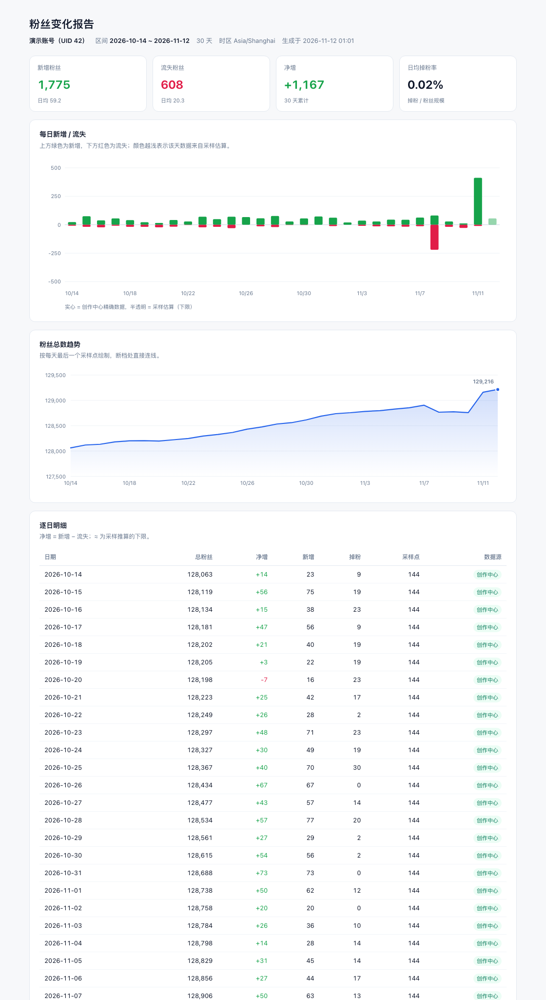
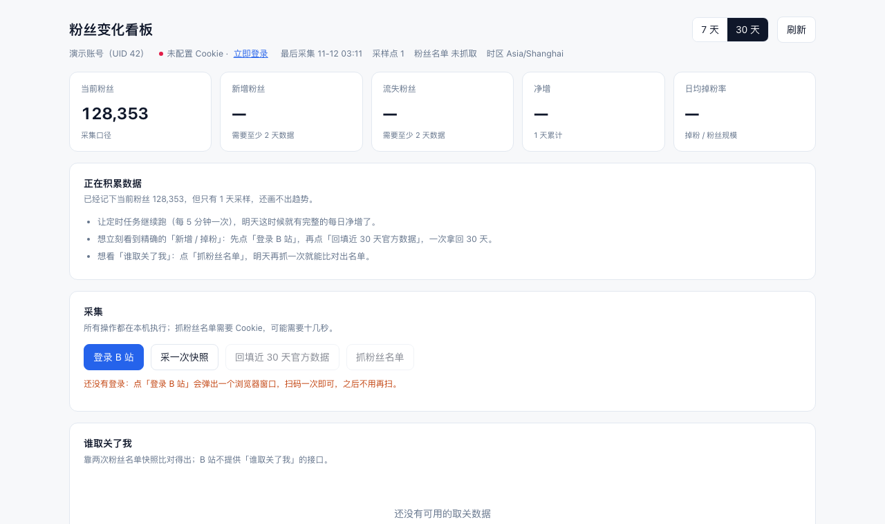
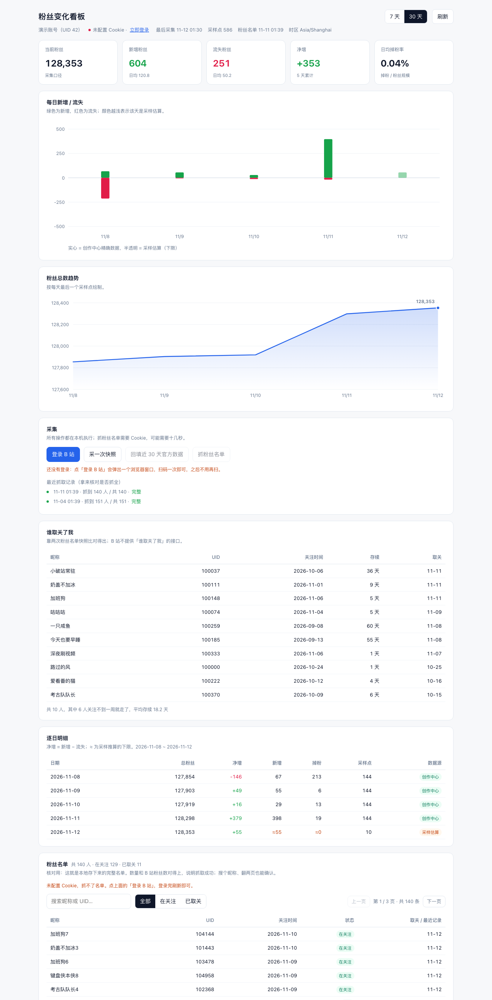

# Bili 掉粉分析 · bilifans

定时记录一个 B 站账号的总粉丝数，并叠加创作中心的官方「涨粉 / 掉粉」数据，
算出**每天新增多少、掉了多少、净增多少**，然后在终端或网页报告里看趋势。

纯 Python 标准库实现，**零第三方依赖**，只用 `python3` 就能跑。



---

## 0. 先搞清楚：B 站到底给不给这两个数？

这决定了整个软件的架构，所以先说结论。

| 数据 | 接口 | 要登录吗 | 精度 | 覆盖范围 |
|---|---|---|---|---|
| 当前总粉丝数 | `api.bilibili.com/x/relation/stat` | 不用 | 精确 | 任意账号、任意时刻 |
| 每日涨粉 / 掉粉 | `member.bilibili.com/x/web/index/stat` | **要 UP 主本人的 SESSDATA** | 精确 | 只有自己的号，近 30 天，T+1 |
| 粉丝列表变化 | `api.bilibili.com/x/relation/fans` | 要 | 精确 | 只适合小号，翻页量大 |

**关键点：总粉丝数只能推出「净增」，推不出「新增」和「掉粉」两项。**

比如今天粉丝从 1000 变成 1002，净增是 +2，但这 +2 可能是
「新增 2、掉粉 0」，也可能是「新增 52、掉粉 50」——只看总数永远分不开。

所以这个软件设计成**两个数据源叠加**：

- **有 Cookie**：每天的新增 / 掉粉直接用创作中心的官方数字，精确。
- **没 Cookie**：只采集总粉丝数，用相邻两次采样的差值去估算，结果只能算**下限**（原因见 2.5）。

两种数据都存在同一个库里，报告里会明确标注哪一行是精确的、哪一行是估算的，
不会把估算值伪装成精确值。

---

## 1. 需要做什么

### 1.1 环境

只要 Python 3.11+（用到了 `tomllib` 和 `zoneinfo`），不需要 `pip install` 任何东西。

```bash
cd Bili掉粉分析
python3 -V            # 确认 >= 3.11
./bin/bilifans --help # 直接可用，不用安装
```

想装成全局命令也可以：`pip install -e .`，之后就能直接敲 `bilifans`。

### 1.2 添加要盯的账号

```bash
./bin/bilifans add 123456 --name 我的号
```

`add` 会顺便抓一次昵称。想改备注就再执行一次 `add`，`--name` 会覆盖。

### 1.3 拿 Cookie（想要精确数据才需要）

**一条命令搞定**：

```bash
./bin/bilifans login
```

会弹出一个**独立 profile** 的 Chrome 窗口并直接打开登录页，你扫码登录一次，
程序就把 Cookie（含 HttpOnly 的 SESSDATA）取回来存好（`~/.bilifans_cookie`，权限 600），
**并且自动把这个号登记为监控对象**——不用再 `add`。

登录状态记在那个 profile 里，下次再 `login` 一般不用重新扫码。

> 网页看板里点 **「登录 B 站」** 是同一个流程，日志会实时打在下方的框里。

`whoami` 正常输出长这样：

```
✓ Cookie 有效
  登录账号  你的昵称（UID 12345678）
  创作中心  可用，近 30 天里有 30 天数据（2026-10-14 ~ 2026-11-12）
  监听列表  已添加：我的号（UID 12345678）
```

> **别用控制台 `document.cookie` 取**：SESSDATA 是 HttpOnly，JavaScript 读不到，
> 只会得到 `undefined`。必须用开发者工具的「应用 / 储存空间」或「网络」面板。
>
> **SESSDATA 等同于账号密码**，只在自己机器上用。完整取法（含 Safari、整段 Cookie、
> 失效排查）见 **[docs/get-cookie.md](docs/get-cookie.md)**。

### 1.4 先跑一次

```bash
./bin/bilifans sync --all     # 采一次快照 + 回填近 30 天
./bin/bilifans report --all   # 终端看表
./bin/bilifans export --all   # 生成网页报告 reports/*.html
./bin/bilifans fans --all     # 抓粉丝名单（想看「谁取关了我」就跑这个，每天一次）
./bin/bilifans churn --days 7 # 看具体是谁取关了你
./bin/bilifans serve          # 或者：打开网页看板，点点鼠标
./bin/bilifans install        # 装成双击就能启动的 App（可选）
```

没有 Cookie 的话，`sync` 里的 backfill 会提示跳过，poll 照常工作。

### 1.5 定时跑起来

**推荐 cron**（每 5 分钟一次）：

```bash
crontab -e
# 加一行，路径换成你自己的
*/5 * * * * cd /Users/tim/Documents/Bili掉粉分析 && ./bin/bilifans sync --all >> logs/cron.log 2>&1
```

macOS 也可以用 `launchd`（模板见 `scripts/com.bilifans.plist.template`），
或者干脆开一个常驻进程：

```bash
./bin/bilifans daemon --all --interval 5
```

采样频率建议 **5 分钟**。更快不会更准（还会被限流），更慢会让估算误差变大。

---

## 2. 基础逻辑

### 2.1 数据流

```
            ┌─────────────────────────────┐
 每 5 分钟  │ api.bilibili.com            │  总粉丝数
 ──────────▶│ /x/relation/stat?vmid=UID   │──────────┐
            └─────────────────────────────┘          │
                                                      ▼
                                          ┌────────────────────┐
 每小时一次 │ member.bilibili.com         │ │  snapshot 表        │
 ──────────▶│ /x/web/index/stat           │ │  (uid, ts, fans)   │
  (需 Cookie)└─────────────────────────────┘ └─────────┬──────────┘
                     │ 每日涨粉/掉粉                    │
                     ▼                                 │
            ┌────────────────────┐                     │
            │ creator_day 表      │                     │
            │ (uid, day, new, lost)│                    │
            └─────────┬───────────┘                    │
                      └──────────┬──────────────────────┘
                                 ▼
                    ┌──────────────────────────┐
                    │ 按「本地日期」聚合 → 报表  │
                    └──────────────────────────┘
```

### 2.2 净增（一定有，且准确）

```
净增(D) = 当天最后一次采样(D) − 前一天最后一次采样(D-1)
```

用「收盘价」相减，而不是当天第一次减上一次，这样能避免跨零点采样造成的抖动。
纯靠总粉丝数就能算，不需要登录，但**只有净增**。

### 2.3 精确口径（有 Cookie）

创作中心接口一次返回近 30 天两个字典：

```json
{"data": {"fan_recent_thirty": {
   "follow":   {"20261110": 12, "20261111": 30},
   "unfollow": {"20261110": 4,  "20261111": 9 }
}}}
```

直接取用：

```
新增(D) = follow[D]
掉粉(D) = unfollow[D]
净增(D) = 新增(D) − 掉粉(D)
```

这就是「新增」和「掉粉」的**正解**，也是这个软件最推荐的使用方式。
注意两个坑：

- **T+1**：今天的数字要等次日中午才刷新，所以「今天」这一行通常还是估算值。
- 日期键缺失时按 0 处理（B 站某天没数据就不返回这个键）。

### 2.4 估算口径（没 Cookie）

把相邻两次采样之间的差值拆成正负两堆：

```
毛新增 = Σ max(0, 采样[i] − 采样[i-1])
毛流失 = Σ max(0, 采样[i-1] − 采样[i])
净增   = 毛新增 − 毛流失
```

### 2.5 为什么估算只能当下限

假设两次采样之间真实发生了「新增 5、取关 3」：

```
采样前 1000 ──(+5)(−3)──▶ 采样后 1002
```

净增确实是 +2，但估算只会看到 `+2`，把它记成「新增 2、掉粉 0」。
那 3 个取关被净增吃掉了。

所以：**估出来的新增和掉粉一定 ≤ 真实值**，采样越密越接近真相，但永远不可能 100% 还原。
报告里所有估算值都带 `≈` 前缀，就是这个意思。

一个推论：**没有 Cookie 时，净增是可信的，新增/掉粉不可信**。别拿它做运营决策。

### 2.6 「一天」的边界

- 默认按 `Asia/Shanghai` 切，`--tz` 可改。
- 边界是本地 00:00:00，不是 UTC，也不是「最近 24 小时」。
- 因此第一天的净增需要「前一天收盘价」做基准，代码会多取两天数据来保证这一点。

### 2.7 断档怎么处理

进程挂了几天没采，会这样处理：

- 中间完全没数据的那天 → 标为「无数据」，不参与合计。
- 跨了 1 天以上的那一段差值 → **不计入**毛新增/毛流失（没法归到某一天，硬算会严重失真）。
- 但净增仍会算出来，并在备注里写「基准点距当天超过 1 天，净增里混着断档期间的变化」。

### 2.8 一行数据从哪来（优先级）

```
有创作中心数据 → 用官方 new/lost，标记「精确」
否则有采样     → 用估算，标记「估算」，数字前加 ≈
两者都没有     → 「无数据」
```

两边都有时，两个数字都会算出来并做一致性校验：
如果 `采样净增` 和 `官方净增` 差得太多（超过 3 或 0.2%），备注里会提示，
通常是采样点太少或 B 站在清理僵尸粉。

---

## 3. 谁取关了我（粉丝名单比对）

### 3.1 为什么必须绕一圈

B 站只提供「当前粉丝列表」，没有任何接口会告诉你「谁离开了」。所以唯一的办法是
**自己存一份名单，下次再抓一份，做差集**：

```
11-11 名单  {A, B, C, D}
11-12 名单  {A, B, D}
          ↓ 差集
    C 取关了（11-12 抓取时发现）
```

第三方「取关查询」工具用的也是这个原理，没有更神奇的路子。

### 3.2 B 站定的硬限制

接口 `x/relation/followers` 的可视范围：

| 身份 | 能看到 |
|---|---|
| 登录后看自己 | **前 1000 名粉丝**（按关注时间，最近的在前面） |
| 未登录看别人 | 前 100 名 / 最多 5 页 |

于是：

- **粉丝数 ≤ 1000**：全量覆盖，取关一个不漏，这是最舒服的场景。
- **粉丝数 > 1000**：只能发现「最近关注的那批人里谁取关了」，
  更早的粉丝取关永远看不到。报告里会写明「仅覆盖最近 N 人」，不假装是全量。

### 3.3 怎么用

```bash
export BILI_COOKIE='SESSDATA=...'
./bin/bilifans fans --uid 123456       # 抓一份名单（第一次只建基线，不判定）
./bin/bilifans fans --uid 123456       # 隔一天再抓，就会打印「谁取关了」
./bin/bilifans churn --days 7          # 近 7 天完整取关名单
./bin/bilifans churn --days 30 --json  # 给脚本用
```

`fans` 抓完会直接列出本次消失的人；`churn` 是汇总视图，多了「关注了多久才走」的存续天数。

定时任务加一条**每天一次**就够（抓 1000 人 = 20 次请求，别每 5 分钟跑）：

```cron
0 6 * * * cd /你的路径 && ./bin/bilifans fans --all >> logs/fans.log 2>&1
```

### 3.4 防误判

一次失败的抓取（风控、断网、只拿到半页）如果把缺的人全判成取关，名单就废了。所以：

- 只有「本次抓到的人数 ≥ 上次的 80%」或「确认抓全了」才做取关判定；
- 否则打 `⚠` 并**跳过本次判定**——宁可漏报，不可误报；
- 每次抓取都在 `fan_crawl` 表留痕（抓了多少、是否完整），可事后追溯。

### 3.5 能看出什么

- **谁**：昵称 + UID（取关后昵称保留最后一次看到的，改名的会显示旧名）
- **哪天走的**：精度 = 你的抓取频率（一天一次 → 精确到天）
- **存续多久**：大量「关注 1~3 天就取关」，通常说明标题/封面与内容不符
- **谁又回来了**：取关后重新关注会记成一次新的 follow，不会被漏掉

想核对抓得全不全，看完整花名册：网页看板底部的「粉丝名单」，或者命令行
`bilifans fans --list`。总数和 B 站粉丝数对得上就说明抓取成功。

---

## 4. 图形界面（网页看板）

不想敲命令就开看板，一条命令：

```bash
./bin/bilifans serve
```

它会启动一个只监听本机的网页服务并自动打开 <http://127.0.0.1:8787>：



页面上能做的事：

- 右上角切 **7 天 / 30 天**，点「刷新」重读本地数据（只监控一个号，不再有账号切换）
- 看 KPI、每日新增/流失柱状图、粉丝总数趋势
- 点 **采一次快照 / 回填近 30 天 / 抓粉丝名单**，日志在按钮下方实时滚动
- 看逐日明细和「谁取关了我」名单
- **粉丝名单**（页面底部）：全量花名册，可搜索昵称/UID、按「全部 / 在关注 / 已取关」筛选、翻页；
  标题旁直接写着 `共 713 人 · 在关注 701 · 已取关 12`

  
- **最近抓取记录**（采集区下方）：每次抓到多少人、是否完整，一眼看出抓取成没成功
- **登录 B 站**：点按钮弹出浏览器窗口扫码，日志实时显示进度；没登录时「回填 / 抓粉丝」会自动置灰

> 核对抓取是否成功就看两个地方：粉丝名单的总数对不对得上 B 站粉丝数；
> 抓取记录里是「完整」还是「撞上上限」。

几个细节：

- 只监听 `127.0.0.1`，不对外网开放；还会校验 `Host` 头，挡掉 DNS rebinding。
- 页面数据全部来自本地 SQLite，不上传任何地方；Cookie 只在服务端使用，不会出现在页面上。
- 抓粉丝名单要十几秒（1000 人 = 20 次请求），所以放在了后台线程，页面不会卡住。
- 换端口：`bilifans serve --port 8888`；不想自动开浏览器：`--no-open`。

### 装成「双击就能用」


```bash
./bin/bilifans install
```

生成两样东西：

| 产物 | 用途 |
|---|---|
| `~/Applications/Bili掉粉分析.app` | 双击启动；拖进 Dock 后一键打开（自带图标） |
| `~/.local/bin/bilifans` | 全局命令，任意目录敲 `bilifans serve` |

几个细节：

- **看板已经在跑时，再点一次只会打开页面**，不会启动第二个服务（靠端口上的 `/api/health` 识别）。
- App 里写死了 Python 的**绝对路径**：从 Finder 启动的进程只有极简 `PATH`，找不到 conda/homebrew 里的 `python3`。
- 启动失败会弹窗提示，日志在 `~/.bilifans/app.log`，不会「闪一下就没了」。
- 只装一样：`--no-app` 或 `--no-cli`；换位置：`--app-dir ~/Desktop`。

> 这层壳只负责「启动」，数据仍在项目目录的 `bilifans.db` 里；删掉 App 不影响任何数据。

图标是现画的（绿色柱子向上＝新增、红色向下＝掉粉，和看板里那张图同一套视觉语言），
源文件在 `assets/icon.png` / `assets/icon.icns`，想改就编辑 `scripts/make_icon.py`
再跑 `python3 scripts/make_icon.py`（需要 Pillow + macOS 的 `iconutil`）。
改完重新 `bilifans install` 即可；Dock 缓存没刷新的话，`killall Dock` 一下。

---

## 5. 数据表

```sql
account(uid, name, note, added_at)                    -- 监听列表
snapshot(uid, ts, fans, following, source)            -- 高频采样，主键 (uid, ts)
creator_day(uid, day, new_fans, lost_fans,            -- 官方每日明细，主键 (uid, day)
            total_fans, fetched_at)

-- 谁取关了我：名单快照 + 流水 + 抓取留痕
fan(owner_uid, fan_uid, uname, mtime,                 -- 当前/曾经关注的粉丝，主键 (owner_uid, fan_uid)
    first_seen_ts, last_seen_ts, gone_ts)             -- gone_ts 非空 = 已确认取关
fan_event(owner_uid, fan_uid, kind, ts, uname)        -- follow / unfollow 流水
fan_crawl(owner_uid, started_ts, fetched, total,      -- 每次抓取的留痕，用来判断是否可信
          complete, note)
meta(k, v)                                            -- 杂项
```

- 采样表按 `(uid, ts)` 去重，同一秒重复写会覆盖，不会撑爆。
- 官方表按 `(uid, day)` 覆盖写，定时任务反复跑是**幂等**的，可以随便重跑补数据。
- 默认库文件 `bilifans.db`，已在 `.gitignore` 里。

---

## 6. 命令速查

```bash
bilifans login                         # 打开浏览器扫码，自动取回 Cookie 并登记账号
bilifans serve [--port 8787]           # 打开网页看板（图形界面）
bilifans install                       # 生成可双击的 App + 全局命令
bilifans whoami                        # 检查 Cookie 有效性、确认登录的是哪个号
bilifans doctor                        # 逐项体检：Cookie / 公开接口 / 登录态 / 创作中心 / 粉丝列表
bilifans add <UID> [--name 昵称]      # 添加账号
bilifans list                          # 看监听列表、最近采样
bilifans rm <UID>                      # 删账号 + 历史数据
bilifans poll [--all|--uid N]          # 采一次总粉丝数
bilifans backfill [--all|--uid N]      # 拉近 30 天官方涨/掉粉
bilifans sync [--all|--uid N]          # poll + backfill，定时任务用这个
bilifans report [--days 30] [--json]   # 终端表格
bilifans export [--days 30] [-o x.html]# 生成网页报告
bilifans fans [--all] [--limit 1000]   # 抓一次粉丝名单，和上次比对出取关（需 Cookie）
bilifans fans --list [--status gone]   # 看已存的全量名单（--search 搜昵称/UID，--page 翻页）
bilifans churn [--days 7] [--json]     # 看具体是谁取关了你
bilifans probe [--uid N]               # 打印接口原始 JSON，排查字段变化
bilifans daemon [--interval 5]         # 常驻定时采集
bilifans seed-demo                     # 灌演示数据，先看效果
```

公共参数：`--db 路径`、`--config 配置文件`、`--tz 时区`、`-q`。

报告里的 `≈` 一律表示「估算下限」，没有 `≈` 的才是官方精确值。

---

## 7. 定时任务模板

**cron**（见 `scripts/crontab.example`）：

```cron
*/5 * * * * cd /你的路径 && ./bin/bilifans sync --all >> logs/cron.log 2>&1
```

**launchd**（macOS，把 plist 放进 `~/Library/LaunchAgents/`）：

```bash
cp scripts/com.bilifans.plist.template ~/Library/LaunchAgents/com.bilifans.plist
# 改里面的路径，然后
launchctl load ~/Library/LaunchAgents/com.bilifans.plist
```

**systemd**（Linux 服务器）用 `systemd/user` + `OnUnitActiveSec=5min` 的 timer。

---

## 8. 已知限制 / 注意事项

1. **Cookie 就是登录态**，等同于密码；只用自己的，别贴到群里或提交仓库。
   取法见 [docs/get-cookie.md](docs/get-cookie.md)，验证用 `bilifans whoami`。
   `bilifans login` 取回的 Cookie 存在 `~/.bilifans_cookie`（权限 600），不会进 git。
2. **创作中心只认本人 Cookie**，看不到别人的涨掉粉。`backfill` / `fans` 会先用 `nav` 确认
   Cookie 属于哪个 UID，不是目标账号就直接跳过，避免把 A 的数据写到 B 头上。
3. **SESSDATA 会过期**（通常几个月）。过期后 `backfill` 报 `-101`，重新复制即可；
   这期间 `poll` 仍然正常工作，只是新增/掉粉退回估算。
4. **官方数据 T+1**，今天的数据要等明天中午。别指望实时。
5. **限流**：内置了退避重试（412 / 429 / 5xx），但别把间隔调到 1 分钟以下，
   也不要开几十个账号一起刷。
6. **粉丝名单只能看最近 1000 人**（见 §3.2），这是 B 站的限制，任何工具都绕不过去。
7. **取关检测有时间精度**：一天抓一次就精确到天，忘记抓的那几天会合并成一次。
8. **别用在别人的账号上**，这个工具只适合自己复盘。
9. **「登录了但还是不通」先跑 `bilifans doctor`**：它会把 Cookie、公开接口、登录态、
   创作中心、粉丝列表逐条试一遍，哪条标 ✗ 就是卡在哪。最常见的两种：
   `-101`（Cookie 过期）和 `-352`（风控，换个网络）。
   **跟用 Safari 还是 Chrome 看板完全无关**——所有请求都在本地 Python 服务里发出，
   浏览器只是个显示器。
10. B 站接口字段偶尔会变。真变了用 `bilifans probe` 看原始返回，改 `api.py` 里的解析即可。

---

## 9. 项目结构

```
.
├── assets/icon.icns          # 应用图标（icon.png 是同一张，给网页当 favicon）
├── bin/bilifans              # 免安装启动器
├── src/bili_fans/
│   ├── api.py                # 两个接口的封装与解析
│   ├── http.py               # UA / Cookie / 重试退避
│   ├── db.py                 # SQLite 读写（幂等）
│   ├── stats.py              # 核心：按天聚合 + 估算 + 一致性校验
│   ├── browser.py            # 用浏览器窗口扫码取 Cookie（CDP over pipe）
│   ├── service.py            # CLI 与网页共用的业务逻辑
│   ├── server.py             # 网页看板（http.server + 单页前端）
│   ├── shortcut.py           # 生成 .app / 全局命令的「一键启动」壳
│   ├── report.py             # 终端表格 + 自包含 HTML（内联 SVG）
│   ├── cli.py                # 命令行
│   ├── config.py             # toml 配置
│   └── demo.py               # 演示数据
├── docs/get-cookie.md        # 怎么拿 SESSDATA（含截图级步骤与排查）
├── tests/                    # 118 个离线测试，不碰网络
├── examples/                 # 演示报告
└── bilifans.toml.example     # 配置模板
```

## 10. 开发

```bash
PYTHONPATH=src python3 -m pytest -q
```

测试全部用假数据 / 假 Transport，不联网（网页接口会在随机端口起个真服务）。核心用例在
`tests/test_stats.py`（净增基准、估算拆分、断档、官方与采样打架）、`tests/test_fans.py`（基线、取关判定、误判防护、翻页上限）
、`tests/test_server.py`（真的起一个 HTTP 服务打接口）
和 `tests/test_browser.py`（Cookie 提取、保存权限、超时提示）。

---

## 11. 免责声明

- 本项目**只读取数据和做统计**，不会点赞、评论、关注、发私信，也不会修改你的账号。
- 所有请求都发往 `*.bilibili.com`，不经过任何第三方服务器；Cookie 只存在你本机。
- B 站接口属于非公开 API，随时可能变。**请控制频率，不要用于批量抓取他人数据**，
  也不要拿它绕过平台风控。
- 请遵守 [哔哩哔哩用户协议](https://www.bilibili.com/protocal/licence.html)，
  因使用本项目产生的任何后果由使用者自负。

## 12. 许可证

[MIT](LICENSE) —— 随便用、随便改，保留版权声明即可。

如果你想二次开发，最短路径是读这三个文件：

| 文件 | 看什么 |
|---|---|
| [stats.py](src/bili_fans/stats.py) | 净增、估算、断档这些口径到底怎么算的 |
| [fans.py](src/bili_fans/fans.py) | 取关检测的比对逻辑和防误判 |
| [api.py](src/bili_fans/api.py) | 所有 B 站接口和字段，改版时只需要动这里 |

## 13. 一句话总结

> **总粉丝数负责「净增 + 高频行情」，创作中心负责「新增 / 掉粉的真相」。**
> 两个源叠在一起，才有每天完整的进出账。
